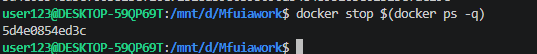
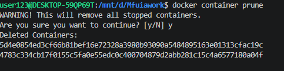
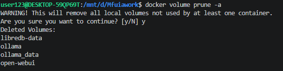
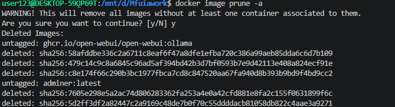
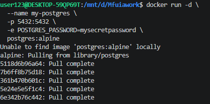
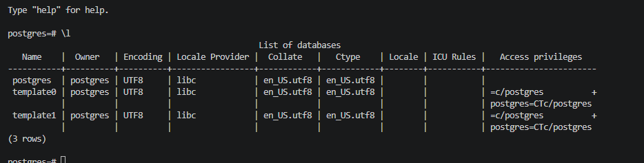
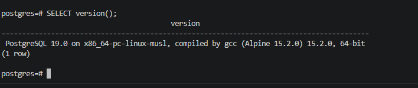
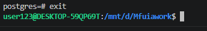

## База данных Redis

- > ## Для выполнения этого задания используйте WSL или любой другой Linux или Mac!

- > Никогда в разработке не используйте русские имена файлов и каталогов!
- > Никогда в разработке не используйте пробелы и спец.символы в именах файлов и каталогов!
- > Перед созданием проекта убедитесь, что порт, который собираетесь использовать не занят другим приложением!
- > Создание проекта лучше начать с "чистого листа", предварительно остановив и удалив все другие контейнеры и образы!

### 1. Подготовка

> **Создание проекта лучше начать с "чистого листа", предварительно остановив и удалив все другие контейнеры и образы!**

Перед выполнением этого задания рекомендуется завершить и удалить все имеющиеся учебные контейнеры:

Остановить все запущенные контейнеры:
```shell
docker stop $(docker ps -q)
```


Удалить все остановленные или не запущенные (Exited, Created) учебные контейнеры:
```shell
docker container prune
```


> **Prune** — удаляйте ненужные контейнеры, чтобы не засорять ваш Docker!

Или так удалить все учебные контейнеры (включая запущенные — принудительно):
```shell
docker rm -f $(docker ps -aq)
```
Очистить все ненужные (учебные) тома:
```shell
docker volume prune -a
```


Опционально: можно удалить образы и кеш сборок в Docker

Удаление всех образов
```shell
docker image prune -a
```


Очистить кэш всех сборок:
```shell
docker builder prune -a
```


- [Подробней про управление Docker в шпаргалке](/Docker/DockerHelp.md)

***

### 2. Получение образа с PostgreSQL, создание и запус контейнера

**Git-Bash/Linux/WSL 2.0/Mac**
```shell
docker run -d \
  --name my-postgres \
  -p 5432:5432 \
  -e POSTGRES_PASSWORD=mysecretpassword \
  postgres:alpine
```


Пароль очевиден: `mysecretpassword`

Подключиться:
```shell
docker exec -it my-postgres psql -U postgres
```
- Выполнить несколько демонстрационных команд, например:

Получить список баз данных:
```sql
\l
```


Получить версию:
```sql
SELECT version();
```


выйти из БД
```sql
exit
```



> Если вы обнаружили ошибку в этом тексте - сообщите пожалуйста автору!

